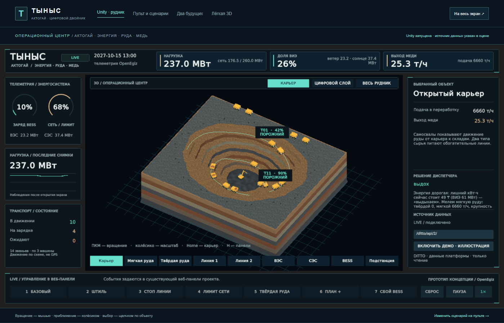

# Тыныс · Актогай — Unity-визуализация

Редактируемая 3D-сцена для проекта `shrailymadil-debug/tynys-aktogay`. Unity **6000.3.2f1**, встроенный рендерер Built-in. Геометрия и материалы созданы программно. При первом открытии Unity скачивает официальный пакет **Post Processing 3.5.4**, закреплённый в Packages/manifest.json. Его совместимость с Unity 6000.3 указана в [документации Unity](https://docs.unity.com/en-us/engine/6000.3/manual/packages-list/packages-all/pack-safe/com-unity-postprocessing).



## Открыть сцену

1. В Unity Hub выберите **Add → Add project from disk** и папку `team/tynys/unity` из этого репозитория.
2. Откройте проект в Unity **6000.3.2f1**.
3. Откройте `Assets/Tynys/Scenes/TynysMine.unity`.
4. Нажмите **Play**. По умолчанию включается **LIVE**: сцена автоматически подключается к API проекта. До первого корректного снимка показатели имеют вид «—». Кнопка **ВКЛЮЧИТЬ ДЕМО · ИЛЛЮСТРАЦИЯ** явно включает автономную иллюстрацию с **09:00**; её время, профиль СЭС и анимационные фазы относятся к одному модельному часу.

Сохранённая сцена содержит объекты и материалы, доступные для редактирования в Hierarchy и Inspector. Если нужно восстановить исходный макет, откройте отдельную пустую сцену и выберите **Tynys → Build editable mine scene**. Эта команда создаёт исходный макет заново и перезаписывает `TynysMine.unity`; ручные изменения в этой сцене предварительно сохраните под другим именем.

Windows-приложение собирается из этого проекта (раздел «Сборка и проверка» ниже). Папка `Tynys_Data`, `UnityPlayer.dll` и остальные файлы сборки должны оставаться рядом с `Tynys.exe`.

## Что показано

- Ступенчатый карьер, спиральный съезд и экскаваторы.
- 14 визуальных звеньев самосвалов: каждый двойник соответствует группе из трёх машин, как в текущей модели проекта.
- Склады мягкой и твёрдой руды, размер которых отражает заполнение.
- Две линии переработки со стеклянными крышами, мельницы, лёгкий иллюстративный пар и флотация.
- ВЭС, СЭС, накопитель, подстанция и зарядка флота.
- Потоки энергии с бегущей текстурой, направление заряда/разряда BESS, состояние линий и подписи мощностей прямо в сцене.
- Русская панель показателей, выбор объекта, режим «вдох/выдох».

Главный экран построен как диспетчерский центр: крупный карьер в центре, слева заряд BESS, использование лимита сети, наблюдаемый ряд нагрузки и состояния флота; справа выбранный объект и решение координатора. График начинает накапливаться после открытия и не выдаётся за архив до запуска экрана. Все значения используют тот же источник LIVE/DEMO, что и верхняя панель.

Три кнопки над сценой переключают **Карьер**, **Цифровой слой** и **Весь рудник**. Крупный карьер показывает слоистый объём породы, непрерывный съезд и те же 14 звеньев транспорта с их состоянием и зарядом. Это второй пространственный масштаб той же модели, а не дополнительные двойники. Цифровой слой рисует контуры геометрии голубыми линиями; он не является облаком точек геодезической съёмки. Общий вид сохраняет фабрику, ВЭС, СЭС, BESS и подстанцию. Выбор оборудования в нижней строке переходит к нему.

Камень, дороги и слои используют процедурные текстуры, техника имеет отдельные ступицы, козырьки и борта. Размещение объектов и движение остаются иллюстративными; фотографий чужого предприятия или вымышленных показаний датчиков в панели нет.

Это **схематический макет**, а не геодезическая реконструкция Актогая. Число видимых ветряков, панелей, контейнеров и флотокамер условное. ВИЭ, BESS, электрический флот и раздельные склады относятся к гипотезе модернизации «Тыныс».

## Управление

| Действие | Управление |
|---|---|
| Вращение камеры | Правая кнопка мыши + движение |
| Сдвиг | Средняя кнопка мыши + движение |
| Масштаб | Колёсико |
| Общий вид | Home |
| Скрыть / показать интерфейс | H |
| Выбрать оборудование | Левый щелчок по объекту или кнопка под макетом |
| Плавно приблизиться к объекту | Щелчок по объекту, его подписи или кнопке под макетом |
| Пауза демо | Пробел / кнопка |
| Скорость демо | 1× / 4× |
| Сценарии | Кнопки или клавиши 1–7 |

Сценарии: базовый, штиль, остановка линии 2, лимит сети KEGOC, твёрдая руда, план +10%, отказ BESS. «Сброс» возвращает исходные время и параметры.

## Данные действующего проекта

Сцена читает **Eclipse Ditto через существующий прокси `tynys-ui`**. Сервисы модели и координатора менять не нужно.

1. Запустите исходный проект по его README (`make up`, затем `make tynys`).
2. Убедитесь, что веб-панель открывается по `http://localhost:8095`.
3. В Unity/приложении оставьте адрес `http://localhost:8095/ditto/api/2/`.
4. LIVE подключается автоматически. После явного перехода в демо нажмите **ВЕРНУТЬСЯ В LIVE**.

В браузерной сборке адрес `/ditto/api/2/` разрешается относительно origin страницы: используется тот же nginx-прокси, который обслуживает веб-пульт. `localhost` компьютера зрителя не используется. Windows поддерживает явный параметр `--tynys-api "https://server.example/ditto/api/2/"`; `--tynys-demo` включает автономную иллюстрацию.

Для другого компьютера укажите адрес доступного прокси проекта. Пароль Ditto хранится на стороне nginx; вводить его в Unity не требуется. Нельзя размещать этот прокси в публичном интернете без защиты.

Опрос выполняется раз в секунду:

```text
GET /ditto/api/2/things?ids=kz.tynys:site,...&fields=thingId,features
```

Значения читаются из `features.<имя>.properties.value`. Поддержаны 28 двойников, включая 14 звеньев транспорта; полный проект содержит дополнительные двойники. `bess.power_mw > 0` означает разряд, `< 0` — заряд. `energy.charge_mw` относится к флоту.

LIVE работает **только на чтение**. Сценарии задавайте через существующую веб-панель проекта: модель изменится через Ditto, а Unity покажет результат. Кнопки локальных сценариев в LIVE отключены.

При недоступности API до первого снимка показатели имеют вид «—». После потери соединения последний корректный снимок сохраняется с маркировкой устаревших данных. Перехода в демо без действия пользователя нет.

Windows и WebGL собираются в **Release**, без Development Build и Script Debugging. Локальный HTTP работает через PlayerSettings.insecureHttpOption = AlwaysAllowed; это требуется прокси на localhost:8095. Настройка не публикует сервис и не добавляет запись в Ditto. Браузер использует same-origin API; отдельный CORS не нужен. При HTTPS API также вызывается через HTTPS.

## Демо и достоверность

Демо — иллюстрация реакции оборудования, **не расчёт MPC и не доказательство экономической эффективности**. В нём не показываются выдуманные результаты сравнения V0/V1/V2 и величина «Тыныс-резерва».

Использованы масштабы текущего кода проекта: ВЭС 300 МВт, СЭС 250 МВт, BESS 60 МВт / 120 МВт·ч, два склада по 200 тыс. т. На момент подготовки базовый предел сети — 260 МВт, событие KEGOC уменьшает его на 80 МВт. Это параметры сценария, а не описание существующего оборудования Актогая.

В LIVE рабочее состояние, груз и SoC приходят из модели проекта. Движение — условная ускоренная анимация, не GPS и не расчёт скорости настоящего самосвала. `route_pos` используется только как начальная фаза при выходе на дорогу; далее loaded/empty непрерывно проходят круг за 90 реальных секунд. Часовые обновления этой иллюстративной фазы не вызывают скачков или движения назад. Положение вычисляется по дороге, без срезания бортов карьера. При stale/паузе движение замирает и затем продолжается с сохранённого места. Для charging/waiting показывается дискретный переход на стоянку; путь от дороги к зарядному месту модель не публикует. ДЕМО сохраняет прежнее сглаживание своей непрерывной фазы. Сцена не управляет реальным оборудованием.

## Состав исходников

| Файл | Назначение |
|---|---|
| `Assets/Tynys/Scenes/TynysMine.unity` | Сохранённая редактируемая сцена |
| `Scripts/MineWorld.cs` | Геометрия, движение, выбор объектов, потоки |
| `Scripts/MineData.cs` | Демо, HTTP-опрос, проверка и чтение JSON |
| `Scripts/MineHUD.cs` | Русский интерфейс |
| `Scripts/MineCamera.cs` | Орбитальная камера и плавный переход к объекту |
| `Scripts/MineCommandView.cs` | Крупный карьер, второй масштаб флота и переключаемый цифровой контур |
| `Scripts/MineSiteLabels.cs` | Подписи мощностей и подачи над объектами |
| `Shaders/EnergyFlow.shader` | Текстурные импульсы на энергетических линиях |
| `Shaders/SurveyLines.shader` | Контуры геометрии и координатная сетка |
| `Scripts/MineVerification.cs` | Проверки по явному параметру запуска |
| `Scripts/MinePlatform.cs` | Встроенный шрифт, профиль WebGL и диагностический статус |
| `Editor/TynysBuilder.cs` | Генерация сцены, проверка связей, сборка |
| `Generated/` | Сохранённые материалы и геометрия |

Пути `Scripts/`, `Editor/`, `Generated/` в таблице относительны `Assets/Tynys/`.

## Сборка и проверка

Дневной Procedural Skybox используется для окружения и отражений, а камера показывает тёмный фон диспетчерского центра. Мягкий туман и трёхцветное освещение хранятся в сцене. Профиль Generated/DaylightPostProcess.asset содержит Bloom, Ambient Occlusion и Color Grading с экспозицией **+0.3 EV**. Все эти параметры доступны в Inspector. Движение и пар останавливаются на паузе и при устаревшем LIVE-снимке.

В меню **Tynys → Validate scene** проверяются связи компонентов, обязательное оборудование, постобработка и разрешение локального HTTP в Release. **Tynys → Build Windows LIVE** создаёт приложение в `Builds/Windows`.

**Tynys → Build Web LIVE** создаёт браузерную версию в `Builds/Tynys`. Для batch-сборки установленным Unity 6000.3.2f1 используйте `-batchmode -quit -buildTarget WebGL -projectPath "…/team/tynys/unity" -executeMethod Tynys.Editor.TynysBuilder.CreateAndBuildWeb -logFile "…/unity-web.log"`. Переменная `TYNYS_WEB_BUILD_PATH` задаёт дополнительную папку доставки. Эта команда пересоздаёт сцену из исходного макета.

Для обновления сайта задайте `TYNYS_WEB_BUILD_PATH` абсолютным путём к `team/tynys/ui/unity` в этом репозитории или скопируйте туда всё содержимое `Builds/Tynys` после успешной сборки. В Git входят готовые файлы WebGL вместе с исходниками: `make tynys` запускает их без установленного Unity Editor.

WebGL-шаблон хранится в `Assets/WebGLTemplates/Tynys`. Выходные файлы имеют стабильные имена `Build/Tynys.loader.js`, `Tynys.framework.js`, `Tynys.data`, `Tynys.wasm`. Сжатие Unity отключено: HTTP-сервер может применять gzip и должен отдавать `.wasm` как `application/wasm`. Сборка однопоточная и не требует cross-origin isolation. Для встраивания используйте `/unity/` в iframe. Файлы следует отдавать по HTTP(S), не открывать через `file://`.

Браузерный профиль рассчитан на настольный WebGL 2: FXAA, Bloom в быстром режиме, AO отключён, фары показываются эмиссионными материалами без 28 дополнительных spotlights. Для обнаруженного программного рендерера (SwiftShader/llvmpipe и аналоги) автоматически выбирается облегчённый профиль: масштаб буфера 0.9, отключены тени, постобработка и частицы; геометрия, данные, skybox и ambient остаются. Статичная геометрия объединяется для отрисовки; техника, роторы, мельницы, склады и индикаторы исключены. Освещение сцены остаётся дневным оформлением, а не моделью положения солнца. Неизменённый DejaVu Sans с кириллицей включён в сборку; лицензия находится рядом со шрифтом в `Assets/Resources/Fonts/DejaVu-LICENSE.txt`. Шрифты ОС зрителя не требуются. В коде заданы ориентиры Application.targetFrameRate 30/15, однако сохранённый vSyncCount=1 имеет приоритет в Web: жёсткого ограничения 15 FPS нет. Частота определяется браузером и нагрузкой. Замеры SwiftShader с указанием версии оформления и условий приведены в ../TESTING.md; они не гарантируют производительность другого устройства.

Шаблон отправляет родителю same-origin сообщения `{type:'tynys-unity', state:'loading'|'ready'|'error', progress:0..1, message}`. `ready` означает загрузку runtime, **не подключение LIVE**. Отдельный read-only `window.tynysStatus` и сообщения `tynys-unity-data` содержат mode, connected, stale, hasSnapshot, snapshotCount, frameCount, renderedFrameCount, softwareRenderer, batchedObjects и hour для проверки получения данных. `renderedFrameCount` растёт после Unity WaitForEndOfFrame; `frameCount` относится к игровому циклу. Секреты и команды управления туда не передаются.

Для автоматической проверки уже собранного приложения:

```powershell
.\Tynys.exe --tynys-verify "C:\path\to\qa-results" -screen-width 1600 -screen-height 900 -screen-fullscreen 0
```

Параметр проверки явно выбирает DEMO перед тестами. Приложение проверит сценарии, старт в 09:00, отсутствие Development Build, геометрию, анимацию, отсутствие сервера, сброс режимов, сохранит PNG и `verification.txt`, затем завершится. Проверка отклоняет полностью чёрный кадр. Для захвата запускайте видимое окно: на этой Windows-машине скрытое окно Unity подавляет отрисовку. Не добавляйте параметр проверки для обычного просмотра.

Проверка загрузки HTTP была выполнена на локальном снимке, полученном настоящими функциями публикации репозитория, с подменой сетевого транспорта. Это не заменяет проверку запущенного Docker-стенда команды.

В репозитории хранятся только исходники (`Assets` с `.meta`, `Packages`, `ProjectSettings`) и готовая WebGL-сборка для главной страницы стенда (`team/tynys/ui/unity/Build`). Чтобы посмотреть сцену, устанавливать Unity не нужно: она открывается на http://localhost:8095 после `make tynys`.
